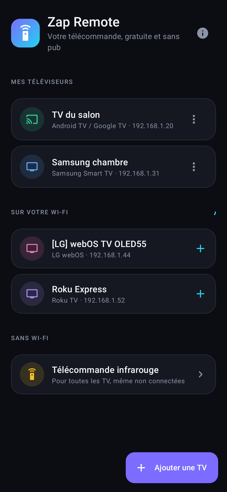
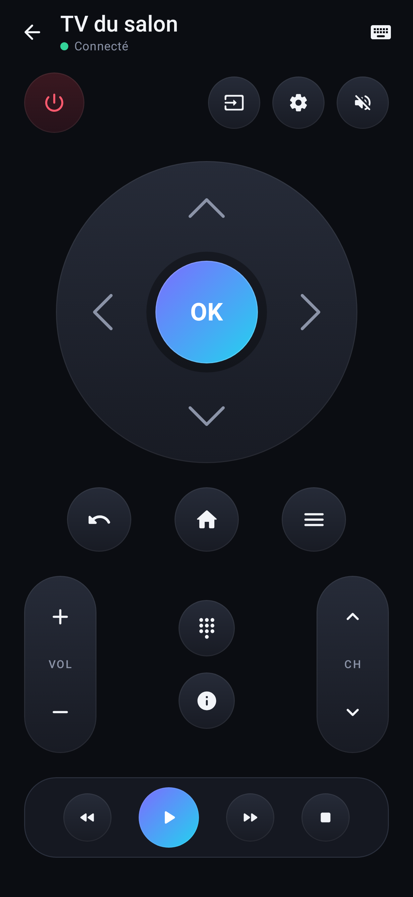

# Zap Remote — télécommande TV gratuite pour Android

Télécommande universelle pour votre téléphone Android : **gratuite, sans pub, sans compte, sans traceur**.
Tout se passe sur votre réseau local, l'application ne contacte aucun serveur sur Internet.

| Liste des TV | Télécommande |
|---|---|
|  |  |

## Compatibilité

| TV | Protocole | Première connexion |
|---|---|---|
| Google TV / Android TV (Sony, Philips, TCL, Hisense, Xiaomi, Sharp, Chromecast…) | Android TV Remote v2 (ports 6466/6467, TLS) | Saisir le code à 6 caractères affiché sur la TV |
| Samsung Smart TV (Tizen, 2016+) | WebSocket (ports 8002/8001) | Accepter la demande sur la TV |
| LG webOS (2014+) | SSAP WebSocket (ports 3000/3001) | Accepter la demande sur la TV |
| Roku TV / Roku | ECP HTTP (port 8060) | Rien |
| N'importe quelle TV (Samsung, LG, Sony, Philips, Panasonic, Toshiba) | Infrarouge | Téléphone avec émetteur IR (Xiaomi, Poco, Redmi, Honor…) |

Fonctions : détection automatique sur le Wi-Fi (mDNS + SSDP), ajout manuel par IP, pavé directionnel,
volume/chaînes avec répétition en maintenant appuyé, boutons volume du téléphone, pavé numérique,
clavier pour écrire sur la TV, allumage par Wake-on-LAN (Samsung/LG), retour haptique.

## Installer

Téléchargez `app-release.apk` puis ouvrez-le sur le téléphone (autorisez « Installer des applis inconnues »
pour votre navigateur ou gestionnaire de fichiers la première fois).

## Compiler

Prérequis : JDK 17+ et le SDK Android (plateforme 36).

```bash
./gradlew :app:testDebugUnitTest   # tests + captures d'écran dans app/build/screenshots
./gradlew :app:assembleDebug       # APK de debug
./gradlew :app:assembleRelease :app:bundleRelease   # APK + AAB signés (voir ci-dessous)
```

La signature release lit `keystore.properties` à la racine (jamais commité) :

```
storeFile=signing/zap-remote-release.jks
storePassword=…
keyAlias=zapremote
keyPassword=…
```

ou les variables d'environnement `TVREMOTE_KEYSTORE`, `TVREMOTE_STORE_PASSWORD`, `TVREMOTE_KEY_ALIAS`, `TVREMOTE_KEY_PASSWORD`.

## Documentation

- [Plan de développement](docs/PLAN.md)
- [Publier sur le Play Store](docs/PLAY_STORE.md)
- [Politique de confidentialité](docs/PRIVACY.md)

## Licence

Voir [LICENSE](LICENSE).
